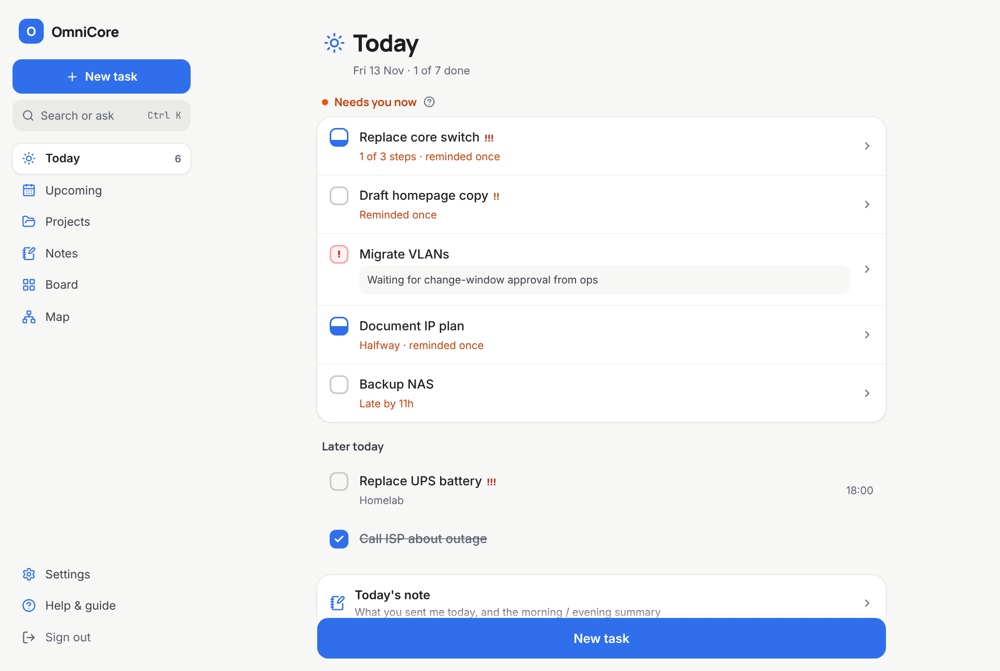
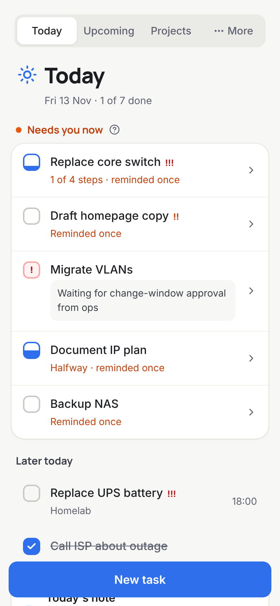
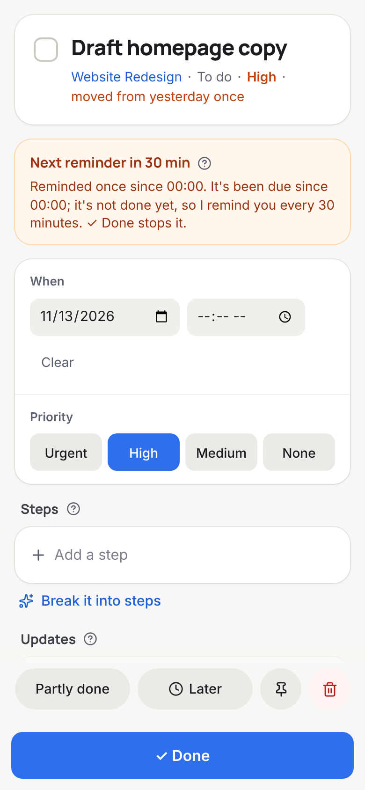
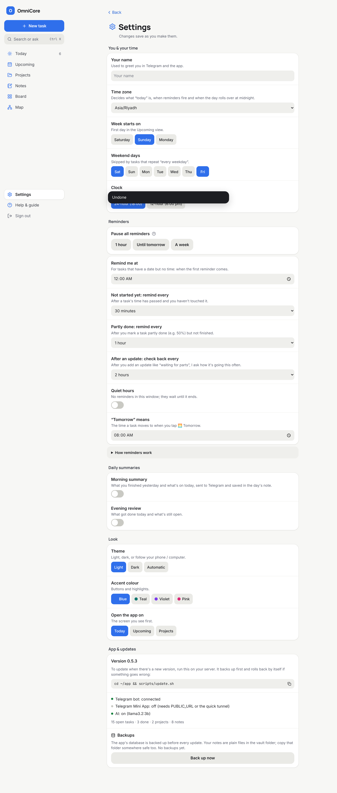

# OmniCore Workspace

**Self-hosted notes + tasks + a Telegram bot that keeps reminding you until things are done.**
Your data stays plain Markdown (Obsidian-compatible). The AI runs locally.



| Telegram Mini App | A task | Settings |
|---|---|---|
|  |  |  |

## What it does

- **Notes and tasks in one place.**
  - Any `- [ ] task` in any note is a task.
  - The web app, Telegram and Obsidian all edit the same `.md` files.
  - Links, backlinks and a graph.
- **Reminders that don't give up.** When a task's time comes you get a Telegram message, and another every 30 min until you tap ✅ Done, say it's partly done, add an update ("waiting for parts") or push it later. Unfinished tasks move to the next day at midnight. Pause everything for a meeting or a holiday.
- **Capture from your phone.** `/todo`, `+ quick task`, notes, voice notes (transcribed, and the tasks you mention are offered for one tap), photos (labels and specs read into a note).
- **One app on the web and in Telegram.** The same screens and plain words in both: Today, Upcoming, Projects, Notes, Board, Map, search. A welcome guide and a Help page explain everything.
- **Settings in the app.** Reminder rhythm, quiet hours, daily summaries, time zone, light/dark and accent colour, backups, and how to update. No `.env` editing needed for any of these.
- **Delete with Undo.** Tasks, projects (keep or delete their tasks) and notes (moved to the vault's `.trash`).
- **Local AI** (Ollama):
  - "Ask" your notes, with sources;
  - break a task into subtasks;
  - a morning standup and an evening retro.

  Cloud models are off unless you turn them on.
- **Runs on one small Linux box** with Docker. Reach it from anywhere through Cloudflare Tunnel, with no open ports.

## Quick start (server)

```bash
git clone https://github.com/<you>/omnicore.git /opt/omnicore && cd /opt/omnicore
cp .env.example .env      # fill in what you want; anything left empty stays off
docker compose up -d      # first start builds the app (a few minutes)
cat data/api-token        # your web password
```

That's it. To turn something on, edit `.env` and run `docker compose up -d` again:

| You want | Put in `.env` |
|---|---|
| Telegram bot + reminders | `TELEGRAM_BOT_TOKEN`, then `TELEGRAM_ALLOWED_USER_IDS` (the bot tells you your id) |
| Local AI | `COMPOSE_PROFILES=ai` (models download by themselves) |
| Telegram Mini App + phone access, instantly | `COMPOSE_PROFILES=quicktunnel` (no Cloudflare account; the bot sends you the https link) |
| Your own domain, permanent | `COMPOSE_PROFILES=tunnel` + `CLOUDFLARE_TUNNEL_TOKEN` |
| Web app on your home network | `LISTEN=0.0.0.0`, then open `http://<server-ip>:3000` |

Combine extras with commas: `COMPOSE_PROFILES=ai,quicktunnel`.

Folders, permissions, the password and the model downloads are all handled on start. Step-by-step with Cloudflare: [docs/DEPLOY.md](docs/DEPLOY.md).

## Updating

```bash
scripts/update.sh          # shows what's new → backs up the DB → updates → verifies → rolls back if broken
```

(The bare-bones way also works: `git pull && docker compose up -d --build`. You just don't get the backup and automatic rollback.)

It works for a git checkout built on the server (default), for prebuilt GitHub images (`OMNICORE_IMAGE`), and for plain Node + systemd. Set `UPDATE_CHECK_REPO=<you>/omnicore` and the app tells you when a release is out. Details: [docs/DEPLOY.md#3-update](docs/DEPLOY.md#3-update).

## Develop

```bash
npm ci                     # Node 22.16+ (24 recommended); no native modules
cp .env.example .env       # API_TOKEN at least
npm run build && npm start # http://127.0.0.1:3000
npm run dev:web            # UI hot reload on :5173
npm run verify             # build + every test suite → PASS/FAIL table in tests/.run/verify/REPORT.md (~4 min)
npm run verify:quick       # build + unit tests (~1 min); runs automatically on `git push`
```

Mocks stand in for Telegram and Ollama, so no real services are needed for any test.

Working with an AI assistant (Claude, Antigravity/Gemini, Cursor…)? It should read **[AGENTS.md](AGENTS.md)** and **[docs/HANDOFF.md](docs/HANDOFF.md)** first. The rules in `.agents/rules/` require it to run `npm run verify` and show the result before calling anything done.

## Docs

| | |
|---|---|
| [docs/GUIDE.md](docs/GUIDE.md) | Using it: Telegram commands, reminders, Markdown syntax, web app, AI |
| [docs/DEPLOY.md](docs/DEPLOY.md) | Install, GitHub setup, updates, backups, troubleshooting |
| [docs/CONFIGURATION.md](docs/CONFIGURATION.md) | Every setting |
| [docs/ARCHITECTURE.md](docs/ARCHITECTURE.md) | How it works inside |
| [docs/API.md](docs/API.md) | HTTP API |
| [docs/PROGRESS.md](docs/PROGRESS.md) · [docs/ROADMAP.md](docs/ROADMAP.md) | What's done · what's next (work diary, sync) |
| [docs/DECISIONS.md](docs/DECISIONS.md) · [CHANGELOG.md](CHANGELOG.md) | Why it's built this way · what changed |
| [TESTING.md](TESTING.md) | Test suites and the latest results |

## Status

v0.5.0 covers the data engine, Telegram + nag engine, web app + Mini App, local AI, and deploy/update tooling.
- **Next**: a work diary (mockups done), then Drive/WebDAV/S3/git sync.
- **Known gaps** (milestones UI, Gantt, filtered list view, `project_index.md`): [docs/PROGRESS.md](docs/PROGRESS.md).

## Credits

Ideas borrowed from the **Obsidian Tasks** plugin (task syntax and recurrence), **Telejournal / Telegram Vault Bot** (chat-first capture), the **Reminder** plugin, **Vikunja** (shared one-tap actions), **Khoj**, **Day One** and **Rosebud** (AI journaling).
